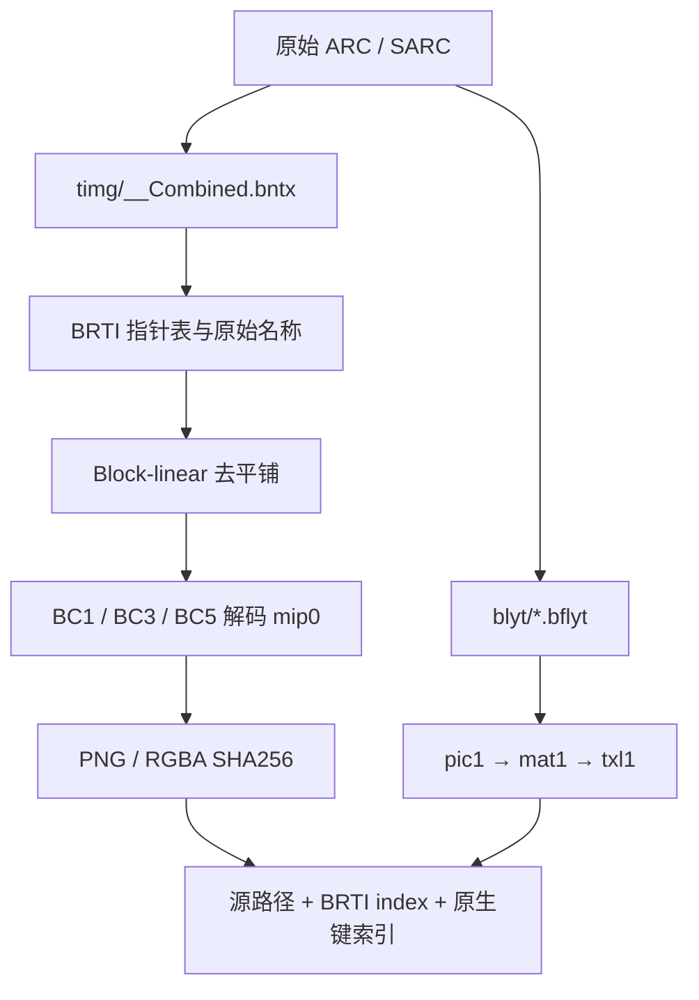

# HOME 4.1.0 属性、语言、游戏版本及出身标记

[返回资源导航](README.md) · [属性原生研究](02-Types.md) · [提取流程](07-Pipeline.md) · [数据库 Schema V1](../../PokemonResourceDatabase/README.md)

本页以 [审计快照](https://github.com/969981/PokeHome_Resources/commit/dfd1085ef769fea9db24ea8c5e43af5b30d1ebe5) 为依据。属性读取已有原生验证索引；语言、版本、出身标记直接读取原始 ARC 的 BNTX/BRTI 指针表，并与 Unpack PNG 文件名对照。游戏版本的25张 PNG 与彩色出身标记12张 PNG 已目视检查；名称按图案描述，不是运行时枚举证明。本轮未重新运行全量解码或 GPU 渲染，不修改原始 NCA、Unpack 或业务代码。

## 1. 资源总览

| 分类 | ARC | 逻辑纹理 | 归档 PNG | 尺寸/格式 | 语义 |
|---|---|---:|---:|---|---|
| 属性 | type_dummy*.arc | 360 | 179 独立 RGBA（Core） | 符号64×64 BC3；文字200×44 BC1 | 原生 display index 已验证 |
| 语言 | lang_icon*.arc | 100 | 10（10份BNTX逐字节相同） | 120×50 BC3 | BRTI 名称明确；PKM LanguageID 待验证 |
| 游戏版本 | icon_version.arc | 25 | 25 | 128×128 BC3 | 图案可辨；GameVersion 映射待证 |
| 普通出身标记 | icon_generation.arc | 12 | 12 | 64×64 BC5 | 通道预览 |
| 彩色出身标记 | icon_generation_color.arc | 12 | 12 | 64×64 BC5 | 通道预览 |

原始根目录 `57b83ea8c0af21ef26e2519b9580b373_NCA/1/bin/appli/`，镜像目录 `Unpack/<NCA>/1/bin/appli/`。归档 [types/switch](../types/switch/)（179）、[types/android](../types/android/)（18）、[languages/switch](../languages/switch/)（10）、[origins/switch](../origins/switch/)（49=25+12+12）按历史 Git blob 命名。优先使用原始路径/纹理名，而不是猜测 hash 名字。历史 [asset_source_index.csv](../asset_source_index.csv) 是路径索引；本次接口未能读出其完整内容。

## 2. 全部语言容器

`type_dummy.arc` 和 `lang_icon.arc` 默认日语；后缀如下。注意 UI locale 和宝可梦自身语言是不同字段。

| 后缀 | 语言 | 属性源文件 | 语言标签源文件 |
|---|---|---|---|
| 无 | 日语 / JPN | [ARC](../../57b83ea8c0af21ef26e2519b9580b373_NCA/1/bin/appli/icon_type/bin/type_dummy.arc) | [ARC](../../57b83ea8c0af21ef26e2519b9580b373_NCA/1/bin/appli/icon_language/bin/lang_icon.arc) |
| eng | 英语 / English | [ARC](../../57b83ea8c0af21ef26e2519b9580b373_NCA/1/bin/appli/icon_type/bin/type_dummy_eng.arc) | [ARC](../../57b83ea8c0af21ef26e2519b9580b373_NCA/1/bin/appli/icon_language/bin/lang_icon_eng.arc) |
| fre | 法语 / French | [ARC](../../57b83ea8c0af21ef26e2519b9580b373_NCA/1/bin/appli/icon_type/bin/type_dummy_fre.arc) | [ARC](../../57b83ea8c0af21ef26e2519b9580b373_NCA/1/bin/appli/icon_language/bin/lang_icon_fre.arc) |
| ger | 德语 / German | [ARC](../../57b83ea8c0af21ef26e2519b9580b373_NCA/1/bin/appli/icon_type/bin/type_dummy_ger.arc) | [ARC](../../57b83ea8c0af21ef26e2519b9580b373_NCA/1/bin/appli/icon_language/bin/lang_icon_ger.arc) |
| ita | 意大利语 / Italian | [ARC](../../57b83ea8c0af21ef26e2519b9580b373_NCA/1/bin/appli/icon_type/bin/type_dummy_ita.arc) | [ARC](../../57b83ea8c0af21ef26e2519b9580b373_NCA/1/bin/appli/icon_language/bin/lang_icon_ita.arc) |
| kor | 韩语 / Korean | [ARC](../../57b83ea8c0af21ef26e2519b9580b373_NCA/1/bin/appli/icon_type/bin/type_dummy_kor.arc) | [ARC](../../57b83ea8c0af21ef26e2519b9580b373_NCA/1/bin/appli/icon_language/bin/lang_icon_kor.arc) |
| ltm | 拉美西语 / LATAM | [ARC](../../57b83ea8c0af21ef26e2519b9580b373_NCA/1/bin/appli/icon_type/bin/type_dummy_ltm.arc) | [ARC](../../57b83ea8c0af21ef26e2519b9580b373_NCA/1/bin/appli/icon_language/bin/lang_icon_ltm.arc) |
| sch | 简体中文 / Simp_Chinese | [ARC](../../57b83ea8c0af21ef26e2519b9580b373_NCA/1/bin/appli/icon_type/bin/type_dummy_sch.arc) | [ARC](../../57b83ea8c0af21ef26e2519b9580b373_NCA/1/bin/appli/icon_language/bin/lang_icon_sch.arc) |
| spa | 西班牙西语 / Spanish | [ARC](../../57b83ea8c0af21ef26e2519b9580b373_NCA/1/bin/appli/icon_type/bin/type_dummy_spa.arc) | [ARC](../../57b83ea8c0af21ef26e2519b9580b373_NCA/1/bin/appli/icon_language/bin/lang_icon_spa.arc) |
| tch | 繁体中文 / Trad_Chinese | [ARC](../../57b83ea8c0af21ef26e2519b9580b373_NCA/1/bin/appli/icon_type/bin/type_dummy_tch.arc) | [ARC](../../57b83ea8c0af21ef26e2519b9580b373_NCA/1/bin/appli/icon_language/bin/lang_icon_tch.arc) |

## 3. 属性图片：18种符号 + 18种文字

[原生索引 JSON](../core/types/index.json) · [像素目录](../core/types/pixels/) · [简中原始归档](../../57b83ea8c0af21ef26e2519b9580b373_NCA/1/bin/appli/icon_type/bin/type_dummy_sch.arc) · [简中解包镜像](../../Unpack/57b83ea8c0af21ef26e2519b9580b373_NCA/1/bin/appli/icon_type/bin/type_dummy_sch/timg/__Combined.bntx/) · [简中名称 TBL](../../57b83ea8c0af21ef26e2519b9580b373_NCA/1/bin/message/Simp_Chinese/megaturtle/typename.tbl) · [DAT](../../57b83ea8c0af21ef26e2519b9580b373_NCA/1/bin/message/Simp_Chinese/megaturtle/typename.dat)

每语言36个 BRTI；360行按 RGBA SHA256 去重为179个物理 PNG（18符号+161文字）。下表来自实际 Core JSON 中简体中文行，PNG 是可直接点击的原始解码结果。

| display index | 消息标签ID | 属性 | 符号 | 简体中文文字 | 原生符号键 / 文字键 |
|---:|---:|---|---|---|---|
| 0 | 0 | 一般 |  |  | `typeIcon_00_normal_00^q` / `typeIcon_text_00_normal_00^o` |
| 1 | 1 | 格斗 |  |  | `typeIcon_01_kakutou_00^q` / `typeIcon_text_01_kakutou_00^o` |
| 2 | 2 | 飞行 |  |  | `typeIcon_02_hikou_00^q` / `typeIcon_text_02_hikou_00^o` |
| 3 | 3 | 毒 |  |  | `typeIcon_03_doku_00^q` / `typeIcon_text_03_doku_00^o` |
| 4 | 4 | 地面 |  |  | `typeIcon_04_jimen_00^q` / `typeIcon_text_04_jimen_00^o` |
| 5 | 5 | 岩石 |  |  | `typeIcon_05_iwa_00^q` / `typeIcon_text_05_iwa_00^o` |
| 6 | 6 | 虫 |  |  | `typeIcon_06_mushi_00^q` / `typeIcon_text_06_mushi_00^o` |
| 7 | 7 | 幽灵 |  |  | `typeIcon_07_ghost_00^q` / `typeIcon_text_07_ghost_00^o` |
| 8 | 8 | 钢 |  |  | `typeIcon_08_hagane_00^q` / `typeIcon_text_08_hagane_00^o` |
| 9 | 10 | 火 |  |  | `typeIcon_09_honoo_00^q` / `typeIcon_text_09_honoo_00^o` |
| 10 | 11 | 水 |  |  | `typeIcon_10_mizu_00^q` / `typeIcon_text_10_mizu_00^o` |
| 11 | 12 | 草 |  |  | `typeIcon_11_kusa_00^q` / `typeIcon_text_11_kusa_00^o` |
| 12 | 13 | 电 |  |  | `typeIcon_12_denki_00^q` / `typeIcon_text_12_denki_00^o` |
| 13 | 14 | 超能力 |  |  | `typeIcon_13_esper_00^q` / `typeIcon_text_13_esper_00^o` |
| 14 | 15 | 冰 |  |  | `typeIcon_14_koori_00^q` / `typeIcon_text_14_koori_00^o` |
| 15 | 16 | 龙 |  |  | `typeIcon_15_dragon_00^q` / `typeIcon_text_15_dragon_00^o` |
| 16 | 17 | 恶 |  |  | `typeIcon_16_aku_00^q` / `typeIcon_text_16_aku_00^o` |
| 17 | 18 | 妖精 |  |  | `typeIcon_17_yousei_00^q` / `typeIcon_text_17_yousei_00^o` |

原生 selector VA `0x2D3DAC`；指针表 `0x784898` 18组，每组16字节，+0 symbol、+8 text。标签 ID 跳过9，不能将 `message_label_id`、`native_display_index` 与外部 PKM TypeID 混为一谈。Python [resolver](../../tools/home41_type_image_resolver.py)；Rust [type_image.rs](../rust/home-image-resource-core/src/type_image.rs)。详见 [原生指针表](../research/NATIVE_TYPE_RESOURCE_CORE.md) 与 [布局证据](../research/TYPE_LAYOUT_BINDING.md)。

## 4. 宝可梦语言标签

[简中原始 ARC](../../57b83ea8c0af21ef26e2519b9580b373_NCA/1/bin/appli/icon_language/bin/lang_icon_sch.arc) · [SARC成员索引](../../Unpack/57b83ea8c0af21ef26e2519b9580b373_NCA/1/bin/appli/icon_language/bin/lang_icon_sch.json) · [解包 PNG](../../Unpack/57b83ea8c0af21ef26e2519b9580b373_NCA/1/bin/appli/icon_language/bin/lang_icon_sch/timg/__Combined.bntx/)

十个语言 ARC 内均为10个 BRTI，BNTX成员偏移8192、大小90240，10份 BNTX 完整字节相同；简中成员 SHA256 `0aed07bcf6a54bd567d2e34f9c4d8928882173b3ea37c3d71d9eb08975762d93`。BRTI格式 `0x1C01` (BC3)，120×50。布局成员 `blyt/lang_icon.bflyt`，pane `P_pict_00`。纹理编号并非 PKM LanguageID。

| BRTI index | 语言 | 原生名称 | PNG |
|---:|---|---|---|
| 0 | 简体中文 | `icon_lang_chs_00^q` |  |
| 1 | 繁体中文 | `icon_lang_cht_00^q` |  |
| 2 | 英语 | `icon_lang_eng_00^q` |  |
| 3 | 法语 | `icon_lang_fra_00^q` |  |
| 4 | 德语 | `icon_lang_ger_00^q` |  |
| 5 | 意大利语 | `icon_lang_ita_00^q` |  |
| 6 | 日语 | `icon_lang_jpn_00^q` |  |
| 7 | 韩语 | `icon_lang_kor_00^q` |  |
| 8 | 拉美西语 | `icon_lang_ltm_00^q` |  |
| 9 | 西班牙西语 | `icon_lang_spa_00^q` |  |

## 5. 游戏版本图标（Version）

[原始 ARC](../../57b83ea8c0af21ef26e2519b9580b373_NCA/1/bin/appli/icon_version/bin/icon_version.arc) · [SARC成员索引](../../Unpack/57b83ea8c0af21ef26e2519b9580b373_NCA/1/bin/appli/icon_version/bin/icon_version.json) · [解包 PNG](../../Unpack/57b83ea8c0af21ef26e2519b9580b373_NCA/1/bin/appli/icon_version/bin/icon_version/timg/__Combined.bntx/)

`timg/__Combined.bntx` 偏移4096，430208字节，SHA256 `412dab9c1f5ca5e1d6cc9dc5bf6704730b72e7d521f795a123e20f6d93bc4282`；`blyt/icon_version.bflyt` pane `P_00`。25个128×128 BC3纹理；以下名称是对原图的目视识别，不代表原生 GameVersion ID 或当前所在游戏判定逻辑。

| BRTI index | 资源编号 | 图案识别（候选） | PNG |
|---:|---|---|---|
| 0 | `icon_version_0000^q` | X |  |
| 1 | `icon_version_0001^q` | Y |  |
| 2 | `icon_version_0010^q` | 欧米伽红宝石 |  |
| 3 | `icon_version_0011^q` | 阿尔法蓝宝石 |  |
| 4 | `icon_version_0020^q` | 太阳 |  |
| 5 | `icon_version_0021^q` | 月亮 |  |
| 6 | `icon_version_0030^q` | 究极之日 |  |
| 7 | `icon_version_0031^q` | 究极之月 |  |
| 8 | `icon_version_0040^q` | Let's Go 皮卡丘 |  |
| 9 | `icon_version_0041^q` | Let's Go 伊布 |  |
| 10 | `icon_version_0050^q` | 剑 |  |
| 11 | `icon_version_0051^q` | 盾 |  |
| 12 | `icon_version_0060^q` | Pokémon GO |  |
| 13 | `icon_version_0070^q` | Pokémon Bank |  |
| 14 | `icon_version_0080^q` | Pokémon HOME 图案 |  |
| 15 | `icon_version_0090^q` | 传说 阿尔宙斯 |  |
| 16 | `icon_version_0100^q` | 晶灿钻石 |  |
| 17 | `icon_version_0101^q` | 明亮珍珠 |  |
| 18 | `icon_version_0110^q` | 朱 |  |
| 19 | `icon_version_0111^q` | 紫 |  |
| 20 | `icon_version_0120^q` | 徽章图案（具体游戏待证） |  |
| 21 | `icon_version_0130^q` | 传说 Z-A 图案 |  |
| 22 | `icon_version_0140^q` | 火红图案 |  |
| 23 | `icon_version_0141^q` | 叶绿图案 |  |
| 24 | `icon_version_9999^q` | 空白占位 |  |

## 6. 宝可梦出身标记（Generation / Origin Mark）

[普通 ARC](../../57b83ea8c0af21ef26e2519b9580b373_NCA/1/bin/appli/icon_generation/bin/icon_generation.arc) · [彩色 ARC](../../57b83ea8c0af21ef26e2519b9580b373_NCA/1/bin/appli/icon_generation/bin/icon_generation_color.arc) · [普通 PNG](../../Unpack/57b83ea8c0af21ef26e2519b9580b373_NCA/1/bin/appli/icon_generation/bin/icon_generation/timg/__Combined.bntx/) · [彩色 PNG](../../Unpack/57b83ea8c0af21ef26e2519b9580b373_NCA/1/bin/appli/icon_generation/bin/icon_generation_color/timg/__Combined.bntx/)

每个 ARC 为69760字节，BNTX偏移8192，61568字节，12个64×64 `0x1E01` (BC5-UNORM) BRTI。两个 BNTX 字节不同；同编号有普通与 color 两变体。现有 decoder 将 R、G 通道直接显示且 B=0，不能作为原生最终色彩或透明度。彩色图目视形状见下。运行时 origin/version 对应表尚未证实，编号不等于世代数。

| index | 普通 BRTI / color BRTI | 形状描述（候选） | 普通原始通道 | 彩色原始通道 |
|---:|---|---|---|---|
| 0 | `icon_generation_00^t` / `icon_generation_00_color^t` | 掌机外形 |  |  |
| 1 | `icon_generation_01^t` / `icon_generation_01_color^t` | 无可见绿色符号（占位候选） |  |  |
| 2 | `icon_generation_02^t` / `icon_generation_02_color^t` | 五边形 |  |  |
| 3 | `icon_generation_03^t` / `icon_generation_03_color^t` | 四叶草 |  |  |
| 4 | `icon_generation_04^t` / `icon_generation_04_color^t` | S 形圆环 |  |  |
| 5 | `icon_generation_05^t` / `icon_generation_05_color^t` | 皮卡丘头形 |  |  |
| 6 | `icon_generation_06^t` / `icon_generation_06_color^t` | G 字圆环 |  |  |
| 7 | `icon_generation_07^t` / `icon_generation_07_color^t` | 四向环形 |  |  |
| 8 | `icon_generation_08^t` / `icon_generation_08_color^t` | 三节点三角 |  |  |
| 9 | `icon_generation_09^t` / `icon_generation_09_color^t` | 星形晶体 |  |  |
| 10 | `icon_generation_10^t` / `icon_generation_10_color^t` | S 形 |  |  |
| 11 | `icon_generation_11^t` / `icon_generation_11_color^t` | 横向掌机 |  |  |

## 7. 如何转换及复现



- [SARC解析器](../../tools/home41_romfs_core.py) `sarc_members()` 定位 member 偏移和大小。
- [BRTI metadata](../../tools/home41_icon_brti_audit.py) `metadata()`：BNTX +36 count、+40 u64 table；BRTI +28 format、+36 width、+40 height、+96 name pointer（u16长度后UTF-8）。保留完整原名和后缀。
- [纹理解码器](../../tools/home41_bntx_to_png.py) `decode_bntx()`：读取 mip0、block-linear deswizzle、BC1/BC3/BC5 解码；BC5 输出通道可视化，不能假装 shader parity。
- [全局纹理导出](../../tools/home41_full_texture_package.py) `full()` 导出 `texture_pixels.csv`、`category_candidates.csv`、`summary.json`，保留原名、source、member、SHA256、PNG路径。
- [属性布局审计](../../tools/home41_type_layout_audit.py) 和 [原生属性打包](../../tools/home41_type_native_package.py) 生成 `type_index.json` 并检查360行与179种像素；后者会写入 `HomeImageResources/core/types/`，建议在独立工作树运行。

从仓库根目录，以 uv 临时环境复现全局纹理审计（现有 CLI，未在本次对话实际运行）：

```powershell
uv run --with texture2ddecoder==1.0.6 --with Pillow==12.0.0 --with capstone==5.0.6 python tools/home41_full_texture_package.py --root . --out .audit/home41-textures
```

按 `source` 过滤 `appli/icon_type/`、`appli/icon_language/`、`appli/icon_version/`、`appli/icon_generation/`。当前全局脚本绑定240 ARC+1 BNTX、9377逻辑纹理基线，版本变化需更新验收基线。

## 8. 数据库与下一阶段

不要直接用资源编号替代业务 ID。建议基于 [Schema V1](../../PokemonResourceDatabase/README.md) 增加四类 resolver，而不是混在一张图标表。

| Resolver（建议） | 业务输入 | 映射状态 |
|---|---|---|
| HomeTypeImageResolver | native_display_index + UI locale + symbol/text | 静态验证；外部 enum 适配另做 |
| HomeLanguageImageResolver | Pokémon language ID → 原生 lang token | BRTI 已定位；ID 选择函数待证 |
| HomeGameVersionImageResolver | 游戏版本/当前游戏 ID → native version key | 25资源已定位；原生 consumer 待证 |
| HomeOriginMarkResolver | Pokémon origin → generation key + style | 24原始通道图；selector 与材质待证 |

建议 CSV / SQL 将 `source_asset`（version/platform/arc/member/BRTI index/raw_name/format/size/source hash）、`pixel_asset`（RGBA hash/path）、`semantic_mapping`（ID domain / native key / locale / variant / evidence/status）分离。语言可将100来源行关联到10个物理图；版本和出身标记不要使用同一 ID 域。缺失映射状态置 unresolved，不填猜测值。

后续：验证 ELF 中 `icon_lang_*`、`icon_version_*`、`icon_generation_*` 的原生资源选择函数、版本枚举转换与 BC5 native material/shader，核对 game version、origin mark、当前所在游戏三个业务语义。原始素材权利归原权利人。
