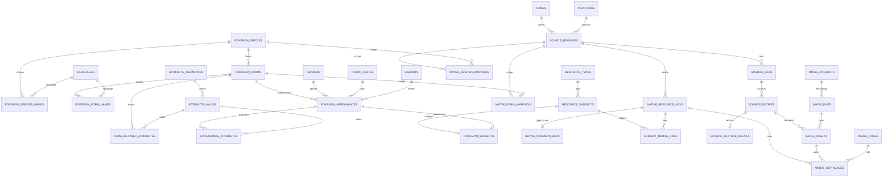

# ER 图（V1）

[返回](../README.md) · [SQL 迁移](../schemas/migrations/0001_initial.sql)

证据、枚举兼容规则、选择器版本等辅助表省略于主图，完整关系以 SQL 和字段字典为准。原生资源可以没有业务实体（例如 species=0 或尚未恢复的形态）；未引用图片可以有 image_asset，但没有 native_key_images。
