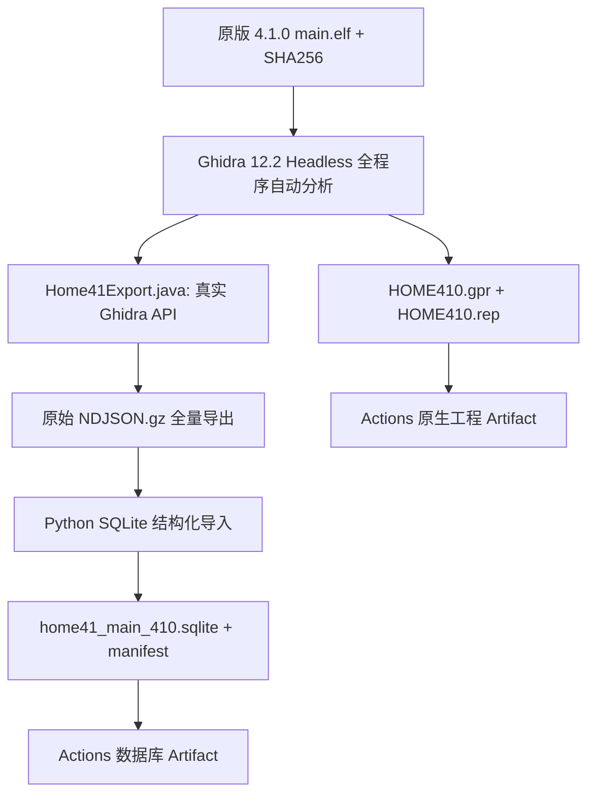

# HOME 4.1.0 main.elf → Ghidra 原生工程 + SQLite

> [!warning] 真实运行状态
> 2026-11-10 的新工作流 [#42758047637](https://github.com/969981/PokeHome_Resources/actions/runs/42758047637) 已创建，但工作 Job 在 GitHub-hosted Runner 分配前失败：`steps=[]`、`runner_name=""`，没有生成可下载的 Ghidra 工程或 SQLite 数据库。因此当前为 **WORKFLOW_COMMITTED / ANALYSIS_NOT_EXECUTED**，不是已成功反编译。

## 1. 原始文件与版本来源

- 仓库：`969981/PokeHome_Resources`，分支 `4.1.0`。
- ELF：`57b83ea8c0af21ef26e2519b9580b373_NCA/0/main.elf`。
- ELF SHA256：`bdb558f795710a89aee1af7ed3b5de359a4ca0b4fef6dcdca62e597b9d45df7a`；**错误版本直接失败**。
- [Ghidra 官方 12.2 Release](https://github.com/NationalSecurityAgency/ghidra/releases/tag/Ghidra_12.2_build)：`ghidra_12.2_PUBLIC_20261016.zip`，SHA256 `2c2cd776db3c1f6a097ba418922378ac3649cadd5e844a6f5f088ae628a7be67`。
- Java 使用 Temurin 25，自动执行 `analyzeHeadless`；**没有把官方 Ghidra 的安装包或 JDK 二进制提交至本仓库**。

## 2. 工作流架构与严格证据界限



这里的全量指 **Ghidra 自动识别到的函数、指令、符号、已定义数据、引用和可反编译函数**。不能保证全部二进制字节被识别为代码，不代表已知道真实运行时 UI 调用栈，不代表反编译 C 与原程序语义等价。

## 3. 数据库内容与字段

| 表或视图 | 数据含义 | 后续使用 |
|---|---|---|
| `metadata` | ELF 原始哈希、image base、CPU language、输入 NDJSON 哈希 | 版本核查 |
| `memory_blocks` | 每个内存块范围、R/W/X、是否初始化 | 区分代码和数据 |
| `functions` | 入口、名称、签名、所属命名空间、函数体范围 | 按地址与功能定位 |
| `instructions` | Ghidra 已反汇编指令的地址、原始机器码、mnemonic、控制流类型 | 核对 ARM64 opcode |
| `references_full` | 指令或数据引用的 source/target、call/jump/data/read/write | 字符串 XREF 与调用追踪 |
| `symbols` | Ghidra 自动/导入符号名称及地址 | 名称检索 |
| `defined_data` | 已定义数据类型与内容；文本 value | itemname 等资源关键词 |
| `decompilation` | 每个函数的 C 伪代码、OK/FAILED/EXCEPTION、错误 | CFG/伪代码审核 |
| `report_counts` | 实际导出记录统计 | 审计覆盖率 |
| `call_edges` | 从 `references_full` 构建的调用边视图 | 静态调用图 |
| `string_items` | Ghidra 识别的字符串视图 | 按资源名称搜索 |
| `symbol_fts` | FTS5 索引（有支持时创建） | 快速符号检索 |

引用指令和函数信息都需要与原版机器码/项目交叉验证。`call_edges` 仅包含 **Ghidra 已识别的显式引用**，无法自动闭合间接 `BLR` 或动态 dispatch。

## 4. 运行命令与产物

[GitHub Actions：HOME41 Ghidra 数据库](https://github.com/969981/PokeHome_Resources/actions/workflows/home41-ghidra-full-database.yml)，默认 `workflow_dispatch` 可选全部反编译，push 更新相关脚本时自动触发。

生成成功才会显示的四组 Artifacts：

- `HOME41-Ghidra12-native-project`：`HOME410_ghidra_project.tar.zst`，内含 `.gpr/.rep`，可重新用 Ghidra 12.2 打开。
- `HOME41-Ghidra12-SQLite`：`home41_main_410.sqlite` 和 `home41_ghidra_manifest.json`。
- `HOME41-Ghidra12-NDJSON`：`home41_ghidra_events.ndjson.gz` 原始事件流，可复算数据库。
- `HOME41-Ghidra12-diagnostics`：Headless 和控制台日志（即使分析脚本失败也尝试上传）。

**Artifacts 不等同于将大体积 Ghidra 工程直接提交 Git 仓库**。工作流采用 30 天 Artifact 保留期，建议下载归档后再进一步分析。

若 GitHub Runner 无法启动，可以在完整原版 ELF 的本地仓库路径中直接执行同等脚本（Ghidra 已安装并配置 Java 25）：

```bash
GHIDRA_HOME=/path/to/ghidra_12.2_PUBLIC
mkdir -p /tmp/home41-ghidra-project /tmp/home41-export
$GHIDRA_HOME/support/analyzeHeadless /tmp/home41-ghidra-project HOME410 \
  -import "$PWD/57b83ea8c0af21ef26e2519b9580b373_NCA/0/main.elf" \
  -scriptPath "$PWD/tools/ghidra" -analysisTimeoutPerFile 15000 -max-cpu 2 \
  -postScript Home41Export.java /tmp/home41-export/main.ndjson.gz all 20
python tools/ghidra/home41_build_sqlite.py \
  --elf 57b83ea8c0af21ef26e2519b9580b373_NCA/0/main.elf \
  --input /tmp/home41-export/main.ndjson.gz \
  --out /tmp/home41-export/main.sqlite \
  --report /tmp/home41-export/manifest.json
```

上述命令必须在拥有原始 ELF 的环境里实际执行后才可能产生真正的数据库。

## 5. SQLite 调用图、符号与道具名称检索

```sql
-- 查 Ghidra 解析的全部函数统计：
SELECT COUNT(*) AS total_functions FROM functions;

-- 原始 Ghidra 字符串关键词（不保证所有二进制字符串自动被定义）：
SELECT addr, preview FROM string_items
WHERE preview LIKE '%itemname%' OR preview LIKE '%item.dat%';

-- 按字符串或符号地址搜索引用者：
SELECT from_addr, to_addr, ref_type, is_call
FROM references_full WHERE to_addr = '0061DEB4';

-- 已识别的函数调用目标：
SELECT from_addr, to_addr, ref_type
FROM call_edges WHERE from_addr BETWEEN '00502000' AND '00502200';

-- Ghidra 的 C 伪代码：
SELECT f.entry,f.name,d.status,d.c FROM functions f
JOIN decompilation d ON f.entry=d.entry
WHERE f.entry='0050213C';
```

注意：地址文本来自 Ghidra 地址显示，须按实际 image base、addr-space 和大小写形式查询。上面的目标地址与范围仅是先前 `item.dat` 证据的检索样例，不代表新的 `itemname` 静态调用链已证明。

## 6. 完整性、误判与下阶段

- Ghidra 的 `analysisTimeoutPerFile` 与 `decompile timeout` 都可能造成某些函数失败或未识别；报告显示 `decompiled_ok / decompiled_failed`。
- SQLite 验证输入 ELF SHA、meta/summary、函数/指令/引用数与 `PRAGMA integrity_check`。
- `DECOMP_REQUESTED=none` 时仍可得到静态指令、数据与引用，但 C 伪代码表为空；因此不能标记为“反编译全部函数”。
- 对 `itemname.dat/.tbl`：先从 `defined_data` 或 Ghidra 项目的内存字节定位字符串，再关联 `references_full`、函数边界，最后才做 MessageManager/GetText/UI 的实机命中。
- Ghidra 未识别到的 `BLR`、虚表或间接跳转必须追加人工/运行时解析，不能把静态 XREF 当成真实 UI 命中。

之前分析：[HOME41 道具 itemname / PML 原版 ELF 静态业务证据](https://github.com/969981/HOME-Live-Plugin-CHS/blob/home-core-editor/docs/research/home-item-catalog/HOME41_itemname%E4%B8%8EPML_itemdat_%E5%8E%9F%E7%89%88ELF%E8%B0%83%E7%94%A8%E9%93%BE%E5%8F%8A%E4%BD%BF%E7%94%A8%E5%9C%BA%E6%99%AF.md)。
